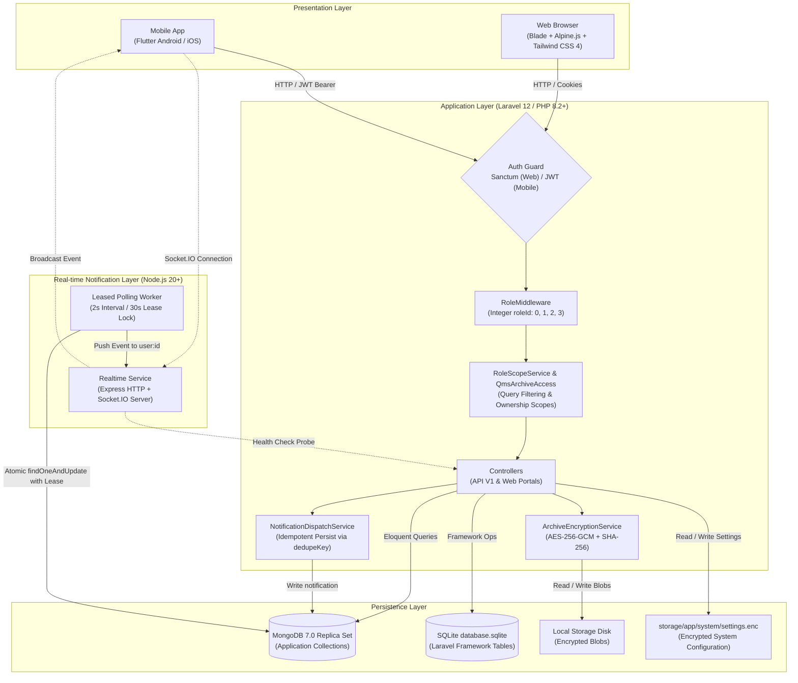

# CompliTrack Technical Architecture & Developer Documentation

**System Version:** 1.0.0-rc  
**Target Environment:** USTP Claveria — College of Engineering and Technology (CET)  
**Primary Standards:** ISO 9001:2015 (Clauses 9.2 & 10.2) · ARTA 3/7/20-Day Rule  

---

## 1. System Overview & Architecture

### 1.1 Purpose & Domain
**CompliTrack** is an institutional regulatory compliance, audit management, and quality assurance platform built specifically for the College of Engineering and Technology (CET) at the University of Science and Technology of Southern Philippines (USTP) Claveria. 

The platform replaces manual paper trails and fragmented file storage with an auditable, encrypted, and real-time digital workflow. It covers:
- **CET QMS Document Archives:** An encrypted file repository organizing evidence by college, academic department, and regulatory taxonomy.
- **Compliance Checks & Audits:** Structured evaluation workflows linking institutional evidence directly to regulatory standards (ARTA, ISO 9001:2015).
- **Corrective Action Requests (CAR):** An automated status tracking engine (`open → in_progress → closed`) with verification requirements.
- **Audit Team Leader (ATL) Workspace:** Scoped management interface for the College Admin/ATL to coordinate audits, review checklists, and monitor corrective timelines.
- **Real-Time Notification Microservice:** Asynchronous event delivery using leased MongoDB polling and Socket.IO room broadcasting.
- **Multi-Client Ecosystem:** Server-rendered web portals (Laravel Blade + Tailwind CSS 4 + Alpine.js) and a native cross-platform mobile application (Flutter).

---

### 1.2 Architectural Component Overview

The application is structured into decoupled functional layers:

1. **API Gateway & Core Application (Laravel 12 / PHP 8.2+):**
   - Exposes RESTful API endpoints under `/api/v1` and serves role-specific web interfaces.
   - Enforces authentication using Laravel Sanctum (session cookies for Web) and JWT (`tymon/jwt-auth` bearer tokens for Mobile).
   - Enforces authorization through `RoleMiddleware` and `RoleScopeService` based on a strict integer `roleId`.
   - Manages AES-256-GCM file encryption, key rotation, and SHA-256 checksum integrity verification.
2. **Primary Application Datastore (MongoDB 7.0 Replica Set):**
   - Managed via `mongodb/laravel-mongodb`.
   - Houses all business domain models: `users`, `colleges`, `departments`, `archive_documents`, `compliance_checks`, `audits`, `notifications`, `audit_logs`, and `qms_categories`.
   - Uses an atomic `counters` collection for sequential, gapless identifiers (`CHK-YYYY-####`, `SA-####`, `FIL-YYYY-####`).
3. **Framework Support Datastore (SQLite):**
   - Connects to `database/database.sqlite` via `DB_CONNECTION=sqlite`.
   - Isolates internal framework tables (relational migrations, framework sessions, cache, and queue jobs) from domain compliance records.
4. **Realtime Notification Microservice (Node.js 20+ / Express / Socket.IO):**
   - Connects directly to the MongoDB replica set.
   - Implements an atomic polling loop with lease locks (`realtimeLease`, `realtimeLeaseUntil`) running every 2000ms.
   - Emits undelivered notifications to authenticated user rooms (`user:<userId>`) and marks records delivered.
5. **Mobile Application (Flutter 3.24+ / Dart 3.5+):**
   - Cross-platform Android/iOS application structured into dedicated navigation shells for Super Admin, Admin, Auditor, and Auditee.
   - Interacts with the backend via the `/api/v1` REST interface and listens for real-time events over Socket.IO.

---

### 1.3 System Architecture Diagram



---

## 2. Directory & File Structure

```
CompliTrack/
├── .github/
│   └── workflows/
│       ├── deploy-backend.yml      # CI/CD pipeline for backend deployment to production host
│       └── flutter-build.yml       # Automated APK compilation workflow
├── app/
│   ├── Casts/                      # Eloquent attribute casting (e.g., NullableObjectId)
│   ├── Console/
│   │   └── Commands/
│   │       └── CheckResetMail.php  # CLI command to verify SMTP & OAuth mail settings
│   ├── Http/
│   │   ├── Controllers/
│   │   │   ├── Api/V1/             # RESTful API controllers (/api/v1/...)
│   │   │   │   ├── ArchiveController.php            # Evidence upload, download, and checksum verification
│   │   │   │   ├── AuditLogController.php           # Immutable audit log queries
│   │   │   │   ├── AuthController.php               # Login, logout, JWT/Sanctum tokens, password reset
│   │   │   │   ├── ComplianceCheckController.php    # Audit evaluations and CAR status transitions
│   │   │   │   ├── DatabaseStatsController.php      # MongoDB storage and collection metrics
│   │   │   │   ├── DepartmentController.php         # Department management and organization summary
│   │   │   │   ├── NotificationController.php       # In-app notifications and admin broadcasts
│   │   │   │   ├── QmsArchiveController.php         # QMS taxonomy tree, categories, and permissions
│   │   │   │   ├── ReportController.php             # Structured compliance report generation
│   │   │   │   ├── SettingsController.php           # Backup, wipe, key rotation, maintenance mode
│   │   │   │   ├── SuperAdminDashboardController.php# System KPIs and component health probes
│   │   │   │   └── UserController.php               # User CRUD, role assignments, directory options
│   │   │   └── Web/                # Server-rendered web portal controllers
│   │   │       ├── AtlWorkspaceController.php       # Audit Team Leader dashboard and records view
│   │   │       ├── AuditController.php              # Auditor checklists, metrics, and assignments
│   │   │       ├── AuditeeController.php            # Evidence request fulfillment and finding responses
│   │   │       ├── AuthController.php               # Web authentication and password reset forms
│   │   │       ├── DashboardController.php          # Route dispatcher based on roleId
│   │   │       └── ProfileController.php            # User profile and password update forms
│   │   └── Middleware/
│   │       ├── EnsureUserIsActive.php  # Blocks deactivated accounts and invalidates tokens
│   │       ├── RoleMiddleware.php      # Enforces route access via integer roleId comparison
│   │       └── SystemAccess.php        # Maintenance mode gatekeeper and global concurrency lock
│   ├── Models/                     # Eloquent MongoDB Models
│   │   ├── ArchiveDocument.php     # Encrypted files, checksums, and QMS metadata
│   │   ├── Audit.php               # Multi-item audit checklists and evidence requests
│   │   ├── AuditLog.php            # Immutable audit trail of write actions
│   │   ├── College.php             # Institutional colleges (CET parent)
│   │   ├── ComplianceCheck.php     # Compliance evaluations, findings, and CAR timelines
│   │   ├── Department.php          # Academic departments and administrative units
│   │   ├── Notification.php        # Persisted alert records and real-time delivery state
│   │   ├── PasswordResetToken.php  # SHA-256 hashed password reset tokens
│   │   ├── PersonalAccessToken.php # Sanctum API token storage
│   │   ├── QmsCategory.php         # Hierarchical QMS document classification taxonomy
│   │   ├── Role.php                # System roles and associated permission lists
│   │   └── User.php                # User credentials, role assignments, and organizational scopes
│   ├── Services/                   # Domain Services & Business Logic
│   │   ├── ArchiveEncryptionService.php    # AES-256-GCM file encryption and decryption
│   │   ├── ArchiveKeyRotationService.php   # Re-encryption worker for rotating storage keys
│   │   ├── AtlWorkspace.php                # Scoped queries and logic for Audit Team Leader
│   │   ├── AuditChecklist.php              # Progress calculation for audit checklist items
│   │   ├── AuditeeEvidenceService.php      # Auditee evidence submission tracking
│   │   ├── AuditLogService.php             # System-wide write activity recorder
│   │   ├── ComplianceCheckService.php      # Check creation, CAR status transitions, and audit logs
│   │   ├── CounterService.php              # Atomic, sequential identifier generator (counters collection)
│   │   ├── NotificationDispatchService.php # Idempotent notification persistence
│   │   ├── PasswordResetService.php        # Time-limited token generation and email delivery
│   │   ├── QmsArchiveAccess.php            # Document and folder visibility authorization engine
│   │   ├── QmsArchivePresenter.php         # Formats archive records for frontend presentation
│   │   ├── RoleScopeService.php            # Master data scoping by roleId
│   │   ├── SuperAdminDashboard.php         # Aggregates system metrics, storage, and health stats
│   │   ├── SystemBackupService.php         # Creates, verifies, and restores encrypted backups
│   │   ├── SystemOperationLock.php         # File-based advisory lock for critical operations
│   │   ├── SystemSettingsService.php       # Encrypted on-disk settings storage (settings.enc)
│   │   ├── SystemWipeService.php           # Secure data wipe preserving Super Admin
│   │   └── UserManagementPresenter.php     # Prepares user directories, counts, and select options
│   └── Support/
│       └── MongoId.php             # Helper for validating and parsing BSON ObjectIds
├── config/                         # Laravel application configurations
│   ├── app.php                     # Application name, version, and locale
│   ├── auth.php                    # Sanctum and JWT authentication guards
│   ├── database.php                # SQLite framework and MongoDB connections
│   ├── mail.php                    # PHPMailer SMTP and OAuth configuration
│   └── services.php                # Third-party integrations and CompliTrack specific keys
├── database/                       # Migrations, seeders, and fixtures
│   ├── database.sqlite             # Relational store for Laravel framework tables
│   ├── mongodb/
│   │   └── init.js                 # MongoDB replica set and index initialization scripts
│   └── seeders/                    # Role and baseline organization seeders
├── docs/                           # Architecture specifications, performance benchmarks, and QMS guides
├── mobile/                         # Cross-Platform Flutter Mobile Application
│   ├── lib/
│   │   ├── core/                   # Constants, network clients, theme definitions
│   │   ├── data/                   # Data sources, repositories, and API clients
│   │   ├── presentation/
│   │   │   ├── navigation/         # Role-based shells (admin, auditee, auditor, super_admin)
│   │   │   ├── providers/          # State management (AuthProvider, etc.)
│   │   │   ├── screens/            # UI screens categorized by role
│   │   │   └── widgets/            # Reusable UI widgets (gauges, KPI cards, badges)
│   │   └── main.dart               # Flutter application entry point
│   └── pubspec.yaml                # Flutter dependencies and version specification
├── realtime/                       # Node.js Realtime Notification Microservice
│   ├── src/
│   │   ├── config/                 # Environment loader and MongoDB client setup
│   │   ├── sockets/                # Socket.IO initialization and JWT authentication
│   │   ├── utils/                  # Structured logger
│   │   ├── watchers/
│   │   │   └── complianceChecksWatcher.js # Leased polling loop for notifications
│   │   └── server.js               # Microservice entry point and health probe
│   ├── test/                       # Unit and integration test suites
│   └── package.json                # Node.js dependencies and script definitions
├── resources/                      # Frontend assets
│   ├── css/                        # Tailwind CSS 4 style definitions
│   ├── js/                         # Client-side JavaScript modules and Alpine.js components
│   └── views/                      # Laravel Blade templates (dashboards, layouts, auth views)
├── routes/
│   ├── api.php                     # Versioned REST API routes (/api/v1/...)
│   ├── console.php                 # Artisan CLI commands (backup, restore, health, logout)
│   └── web.php                     # Web portal routes and profile endpoints
├── scripts/                        # Maintenance, index setup, and verification scripts
│   ├── apply-notification-indexes.php # Applies notification indexes safely
│   ├── bump-version.js             # Semantic version bumping across components
│   └── verify-atl-workspace.php    # Automated workspace verification script
└── tests/                          # Automated Test Suites
    ├── Browser/                    # Puppeteer end-to-end browser test suites
    ├── Feature/                    # PHPUnit feature tests for API and web portals
    └── Unit/                       # PHPUnit and JavaScript unit test suites
```

---

## 3. Setup & Configuration

### 3.1 Prerequisites
Before configuring CompliTrack, ensure the following runtimes and tools are installed:
- **PHP 8.2 or higher** with Composer and the PHP `mongodb` extension (`ext-mongodb`) enabled.
- **Node.js 20.0 or higher** with `npm`.
- **MongoDB 7.0 Community or Enterprise** (Local replica set or MongoDB Atlas cluster).
- **Docker & Docker Compose** (Required for running the local single-node replica set).
- **Flutter SDK 3.24+ / Dart 3.5+** (Required for mobile development; Flutter 3.38.1+ for production builds).

---

### 3.2 Local Development Setup

#### Automated Windows Quick Start
For Windows PowerShell environments, use the automated setup and launch script:
```powershell
.\start-complitrack.ps1
```
*This script validates prerequisites, initializes `.env` files, generates app keys, verifies MongoDB connectivity, runs database seeders, builds frontend assets, and launches Laravel, Vite, and the Node.js realtime service concurrently.*

To terminate all running application processes (leaving MongoDB active):
```powershell
.\stop-complitrack.ps1
```

#### Manual Installation Steps

1. **Clone the Repository:**
   ```bash
   git clone https://github.com/MickoAndrei/CompliTrack.git
   cd CompliTrack
   git checkout Development
   ```

2. **Backend Setup (Laravel):**
   ```bash
   composer install
   cp .env.example .env
   php artisan key:generate
   ```

3. **Generate AES-256-GCM Encryption Key:**
   Run the following command to generate a cryptographically secure 32-byte Base64-encoded key:
   ```bash
   php -r "echo base64_encode(random_bytes(32)), PHP_EOL;"
   ```
   Copy the output and assign it to `ENCRYPTION_KEY` in your `.env` file.

4. **Initialize MongoDB Replica Set (Docker):**
   CompliTrack requires a MongoDB replica set (`rs0`) for change stream and transaction support:
   ```bash
   docker compose up -d mongodb
   php artisan mongodb:check
   ```

5. **Run Migrations & Seeders:**
   ```bash
   php artisan migrate --force
   php artisan db:seed
   ```
   *Note: `db:seed` reads initial Super Admin credentials from `.env`. On local environments, it generates fictional demo departments, auditors, and auditees, outputting their generated passwords once in the console.*

6. **Compile Frontend Assets:**
   ```bash
   npm install
   npm run build
   # Or run Vite dev server for hot reloading:
   npm run dev
   ```

7. **Configure & Start Realtime Service (Node.js):**
   ```bash
   cd realtime
   npm install
   cp .env.example .env
   npm run dev
   cd ..
   ```

8. **(Optional) Configure Mobile Application (Flutter):**
   ```bash
   cd mobile
   flutter pub get
   flutter run
   cd ..
   ```

---

### 3.3 Environment Variables Reference

#### Root Backend Configuration (`.env`)

| Variable Name | Description | Default / Example Value | Required? |
|---|---|---|:---:|
| `APP_NAME` | Application title used in notifications and emails | `CompliTrack` | Yes |
| `APP_ENV` | Application environment (`local`, `production`, `testing`) | `local` | Yes |
| `APP_KEY` | Laravel 32-character application encryption key | `base64:...` | Yes |
| `APP_DEBUG` | Enables detailed stack traces and debugging | `true` (local) / `false` (prod) | Yes |
| `APP_URL` | Public-facing URL of the Laravel application | `http://localhost:8000` | Yes |
| `DB_CONNECTION` | Database connection for Laravel framework tables | `sqlite` | Yes |
| `MONGODB_URI` | MongoDB replica set connection URI string | `mongodb://localhost:27017/?replicaSet=rs0&directConnection=true` | Yes |
| `MONGODB_DATABASE` | Primary MongoDB database name | `complitrack` | Yes |
| `JWT_SECRET` | Secret key used for signing mobile JWT bearer tokens | `[At least 32 random characters]` | Yes |
| `SUPER_ADMIN_EMAIL` | Email address for initial Super Admin provisioning | `admin@example.edu` | Yes |
| `SUPER_ADMIN_PASSWORD` | Password for initial Super Admin provisioning (min 12 chars) | `[Unique Passphrase]` | Yes |
| `ENCRYPTION_KEY` | Base64-encoded 32-byte key for AES-256-GCM file storage | `base64:...` | Yes |
| `NODE_SOCKET_URL` | Base URL of the Node.js realtime Socket.IO service | `http://localhost:4000` | Yes |
| `REALTIME_HEALTH_URL` | Direct URL for Laravel health checks to probe the realtime service | `http://localhost:4000/health` | No |
| `SESSION_DRIVER` | Session storage driver | `file` or `mongodb` | Yes |
| `CACHE_STORE` | Cache storage store | `file` or `mongodb` | Yes |
| `MAIL_MAILER` | Mailer transport for password reset notifications | `phpmailer` | Yes |
| `MAIL_HOST` | SMTP server host | `smtp.office365.com` | Yes |
| `MAIL_PORT` | SMTP port | `587` | Yes |
| `MAIL_ENCRYPTION` | Transport encryption protocol (`tls`, `ssl`) | `tls` | Yes |
| `MAIL_AUTH_TYPE` | SMTP authentication mechanism (`XOAUTH2`, `LOGIN`) | `XOAUTH2` or `LOGIN` | Yes |
| `MAIL_USERNAME` | SMTP sending mailbox username | `compliance@ustp.edu.ph` | Yes |
| `MAIL_PASSWORD` | SMTP password or App Password (if LOGIN) | `[Password]` | Conditional |
| `MAIL_OAUTH_TENANT_ID`| Microsoft 365 Entra ID Tenant ID | `[UUID]` | Conditional |
| `MAIL_OAUTH_CLIENT_ID`| Microsoft 365 App Registration Client ID | `[UUID]` | Conditional |
| `MAIL_OAUTH_CLIENT_SECRET` | Microsoft 365 Client Secret | `[Secret]` | Conditional |
| `MAIL_FROM_ADDRESS` | Sender email address for outgoing messages | `no-reply@ustp.edu.ph` | Yes |

#### Realtime Service Configuration (`realtime/.env`)

| Variable Name | Description | Default / Example Value | Required? |
|---|---|---|:---:|
| `PORT` | Listening port for Express and Socket.IO server | `4000` | Yes |
| `MONGODB_URI` | Replica set connection URI (inherited from root `.env` if omitted)| `mongodb://localhost:27017/?replicaSet=rs0&directConnection=true` | Yes |
| `MONGODB_DATABASE` | MongoDB database name | `complitrack` | Yes |
| `JWT_SECRET` | JWT verification secret (must match Laravel `JWT_SECRET`) | `[At least 32 characters]` | Yes |
| `SOCKET_CORS_ORIGIN` | Allowed CORS origins for incoming socket connections | `http://localhost:8000` | Yes |

---

## 4. Core Modules & Logic

### 4.1 Archive Encryption Service (`App\Services\ArchiveEncryptionService`)
Manages envelope-grade symmetric encryption for uploaded compliance documents at rest.

- **Algorithm:** Authenticated **AES-256-GCM** via PHP OpenSSL.
- **Initialization Vector (IV):** Cryptographically randomized 12-byte binary vector generated per file via `random_bytes(12)` and stored as Base64.
- **Authentication Tag:** 16-byte GCM authentication tag generated during encryption and verified during decryption.
- **Key Resolution & Rotation:** Supports active key retrieval from `config('services.complitrack.encryption_key')` or dynamic key IDs managed by `SystemSettingsService` and `ArchiveKeyRotationService`.
- **Key Methods:**
  - `encrypt(string $plaintext): array`  
    *Returns:* `['ciphertext' => string, 'iv' => string, 'tag' => string, 'keyId' => ?string]`.
  - `decrypt(string $ciphertext, string $iv, string $tag, ?string $keyId = null): string`  
    *Validates IV length (12 bytes) and Tag length (16 bytes); throws `RuntimeException` on authentication failure or corrupted payload.*

---

### 4.2 Role-Based Scoping Engine (`App\Services\RoleScopeService`)
Provides centralized query isolation across MongoDB collections based on the authenticated actor's integer `roleId`:

| Role ID | Role Name | Visibility & Query Restrictions |
|:---:|---|---|
| `0` | **Super Admin** | Unrestricted read/write across users, departments, and audit logs. Read-only folder/storage metrics for QMS archives (file contents and downloads denied). |
| `1` | **Admin / ATL** | Scoped to CET College. Read-only user/department directory. Scoped access to submitted audits where assigned as `reviewerId`, and college-wide compliance checks. |
| `2` | **Auditor** | Scoped strictly to assigned departments (`assignedDepartmentIds`). Can only access checks where `auditorId == actor._id`. Accesses archives explicitly shared via audits. |
| `3` | **Auditee** | Scoped strictly to own department (`departmentId`). Can only view compliance checks where `auditeeId == actor._id` and own evidence request items. |

---

### 4.3 Compliance & Corrective Action Engine (`App\Services\ComplianceCheckService`)
Handles compliance check evaluations and the automated lifecycle of Corrective Action Requests (CARs).

- **Sequential Numbering:** Uses `CounterService::next('CHK', yearly: true)` to generate unique identifiers formatted as `CHK-YYYY-0001`.
- **Corrective Action Transitions:**
  State transitions are strictly validated using a finite state machine:
  $$\text{open} \longrightarrow \text{in\_progress} \longrightarrow \text{closed} \longleftrightarrow \text{open (reopened)}$$
  - Closing a check requires recorded verification remarks (`remarks`).
  - Reopening a closed check requires explanatory remarks (`remarks`).
- **Optimistic Concurrency Control:**
  Updates use MongoDB atomic conditional updates:
  ```php
  $result = $collection->updateOne(
      ['_id' => $checkId, 'correctiveStatus' => $previousStatus],
      ['$set' => [...], '$push' => ['statusHistory' => [...]]]
  );
  if ($result->getModifiedCount() !== 1) {
      abort(409, 'The check was updated by another request. Refresh and retry.');
  }
  ```
- **Automated Notifications:** Dispatches idempotent notification records via `NotificationDispatchService::persist()` upon creation and state updates.

---

### 4.4 Realtime Notification Watcher (`realtime/src/watchers/complianceChecksWatcher.js`)
An independent Node.js process that polls MongoDB for undelivered notifications and dispatches them via WebSockets.

- **Concurrency Protection via Leases:**
  To allow horizontal scaling of realtime workers without duplicate delivery, workers acquire a 30-second lease using atomic `findOneAndUpdate`:
  ```javascript
  const notification = await notifications.findOneAndUpdate(
    {
      realtimeDeliveredAt: { $exists: false },
      $or: [
        { realtimeLeaseUntil: { $exists: false } },
        { realtimeLeaseUntil: { $lt: now } }
      ]
    },
    {
      $set: {
        realtimeLease: leaseId,
        realtimeLeaseUntil: new Date(now.getTime() + 30000)
      }
    },
    { sort: { createdAt: 1, _id: 1 }, returnDocument: 'after' }
  );
  ```
- **Dispatch & Acknowledgment:**
  If the recipient user is active in MongoDB, the event is emitted to Socket.IO room `user:<recipientUserId>`. Upon completion, `realtimeDeliveredAt` is stamped and the lease fields are unset.

---

### 4.5 System Operations & Safeguards (`App\Services\SystemOperationLock` & `SystemSettingsService`)
- **System Operation Lock:** Employs an advisory file lock (`flock`) on `storage/app/system/system-operation.lock`. Prevents concurrent execution of administrative operations (backups, key rotations, full wipes, and migrations).
- **Encrypted Settings Store:** Persists application configuration (`backupsEnabled`, `maintenanceEnabled`, `archiveKeyId`, `archiveKeys`) in an encrypted file (`settings.enc`) using Laravel's `Crypt::encryptString`.

---

## 5. API Reference & CLI Commands

### 5.1 Authentication Endpoints

#### `POST /api/v1/auth/login`
Authenticates a user and issues a stateful session (Web) or a JWT token (Mobile). Throttled to 5 requests per minute per IP.

**Request Payload:**
```json
{
  "email": "auditor.it@ustp.edu.ph",
  "password": "SecurePassword123!",
  "remember": false
}
```

**Success Response (`200 OK` - Mobile / API Client):**
```json
{
  "token": "eyJhbGciOiJIUzI1NiIsInR5cCI6IkpXVCJ9...",
  "tokenType": "bearer",
  "expiresIn": 3600,
  "user": {
    "_id": "672f00000000000000000001",
    "userCode": "AUD-0002",
    "fullName": "Engr. Jane Auditor",
    "email": "auditor.it@ustp.edu.ph",
    "roleId": 2,
    "roleSlug": "auditor",
    "departmentId": "6aeac5b48ce89fe741003b36",
    "assignedDepartmentIds": ["6aeac5b48ce89fe741003b36"],
    "isActive": true
  }
}
```

#### `GET /api/v1/auth/me`
Retrieves the currently authenticated user's profile and assigned scopes. Requires `auth:sanctum,api`.

---

### 5.2 Compliance & Audit Endpoints

#### `POST /api/v1/compliance-checks`
Creates an audit evaluation check. Restricted to role `2` (Auditor).

**Request Payload:**
```json
{
  "departmentId": "6aeac5b48ce89fe741003b36",
  "auditeeId": "672f00000000000000000003",
  "referenceStandard": "ISO9001-9.2",
  "result": "non_compliant",
  "remarks": "Missing Q3 internal audit schedule verification records.",
  "linkedArchiveIds": ["672f10000000000000000010"]
}
```

**Success Response (`201 Created`):**
```json
{
  "data": {
    "_id": "67332f100000000000000099",
    "checkCode": "CHK-2026-0012",
    "departmentId": "6aeac5b48ce89fe741003b36",
    "auditorId": "672f00000000000000000001",
    "auditeeId": "672f00000000000000000003",
    "referenceStandard": "ISO9001-9.2",
    "result": "non_compliant",
    "remarks": "Missing Q3 internal audit schedule verification records.",
    "correctiveStatus": "open",
    "statusHistory": [
      {
        "status": "open",
        "changedByUserId": "672f00000000000000000001",
        "remarks": "Finding created",
        "timestamp": "2026-11-12T13:28:40.000Z"
      }
    ],
    "linkedArchiveIds": ["672f10000000000000000010"],
    "dueDate": "2026-11-19T13:28:40.000Z",
    "closedAt": null,
    "createdAt": "2026-11-12T13:28:40.000Z",
    "updatedAt": "2026-11-12T13:28:40.000Z"
  }
}
```

#### `PATCH /api/v1/compliance-checks/{id}/status`
Transitions a corrective action status. Restricted to role `2` (Auditor).

**Request Payload:**
```json
{
  "correctiveStatus": "in_progress",
  "remarks": "Auditee submitted updated Q3 schedule. Verification underway."
}
```

---

### 5.3 QMS Archive Endpoints

#### `POST /api/v1/archives/upload`
Uploads and encrypts a compliance evidence file (PDF, DOCX, PNG, JPEG; max 20 MB).

**Form-Data Parameters:**
- `file`: Multipart file binary (Required).
- `departmentId`: 24-character hexadecimal BSON ObjectId string (Required).
- `referenceStandard`: Must be one of `ARTA-3days`, `ARTA-7days`, `ARTA-20days`, `ISO9001-9.2` (Required).
- `title`: String, max 255 chars (Optional).
- `categoryId`: 24-character hexadecimal ObjectId (Optional).

**Success Response (`201 Created`):**
```json
{
  "data": {
    "_id": "673330000000000000000055",
    "fileCode": "FIL-2026-0042",
    "originalName": "Q3_Internal_Audit_Schedule.pdf",
    "mimeType": "application/pdf",
    "fileSize": 154820,
    "checksum": "e3b0c44298fc1c149afbf4c8996fb92427ae41e4649b934ca495991b7852b855",
    "departmentId": "6aeac5b48ce89fe741003b36",
    "referenceStandard": "ISO9001-9.2",
    "isEncrypted": true,
    "createdAt": "2026-11-12T13:30:00.000Z"
  }
}
```

#### `GET /api/v1/archives/{id}/download`
Decrypts and streams an encrypted file back to the client. Returns HTTP `200` with the appropriate `Content-Type` header, or HTTP `403` if unauthorized.

---

### 5.4 Administrative CLI Commands

CompliTrack registers custom Artisan CLI commands for operations and disaster recovery:

```bash
# 1. Verify MongoDB connectivity and replica set change streams
php artisan mongodb:check
# Ping only:
php artisan mongodb:check --ping

# 2. Create an authenticated, encrypted database and uploads backup
php artisan complitrack:backup

# 3. Cryptographically verify an encrypted backup package
php artisan complitrack:backup-verify storage/app/system/backups/backup-2026-11-12.enc

# 4. Restore an encrypted backup into a NEW database and directory
php artisan complitrack:backup-restore <file-path> <target-db-name> <target-directory>

# 5. Clear all active sessions, remember tokens, and personal access tokens
php artisan complitrack:logout-all

# 6. Validate password-reset SMTP and OAuth configuration without sending emails
php artisan mail:check
```

---

## 6. Database Schema & Data Models

All application collections reside in the MongoDB `complitrack` database.

### 6.1 `users` Collection
Represents system actors and their organizational assignments.

```typescript
interface UserDocument {
  _id: ObjectId;
  userCode: string;               // e.g., "SA-0001", "ADM-0001", "AUD-0002", "ATE-0005"
  fullName: string;
  email: string;                  // Unique, lowercased index
  password: string;               // Bcrypt hashed string (cost factor 12)
  roleId: number;                 // 0: Super Admin, 1: Admin/ATL, 2: Auditor, 3: Auditee
  roleSlug: string;               // "super_admin" | "admin" | "auditor" | "auditee"
  departmentId?: ObjectId | null; // Primary department
  assignedDepartmentIds?: ObjectId[]; // For Auditors: departments permitted to audit
  officeName?: string | null;     // Descriptive office/unit title
  isActive: boolean;              // Account status
  archiveResponsibility?: string; // e.g., "college_dean", "department_head", "faculty_staff"
  archiveUnitIds?: ObjectId[];    // Scoped archive departments
  archiveCollegeIds?: ObjectId[]; // Scoped archive colleges
  lastLoginAt?: Date;
  createdAt: Date;
  updatedAt: Date;
}
```

---

### 6.2 `departments` Collection
Academic departments and administrative units within USTP Claveria CET.

```typescript
interface DepartmentDocument {
  _id: ObjectId;
  departmentCode: string;         // e.g., "CET-IT", "CET-ABE", "CET-DEAN"
  departmentName: string;         // e.g., "Information Technology"
  collegeName: string;            // Standardized to "CET"
  campusName: string;             // "USTP Claveria"
  collegeId: ObjectId;            // Reference to colleges collection
  unitType: string;               // "academic_department" | "college_office" | "legacy_unclassified"
  headUserId?: ObjectId | null;   // Assigned department head
  ownershipVerified: boolean;     // QMS organizational verification state
  isActive: boolean;
  createdAt: Date;
}
```

---

### 6.3 `archive_documents` Collection
Cryptographically secured compliance evidence records and QMS classification metadata.

```typescript
interface ArchiveDocument {
  _id: ObjectId;
  fileCode: string;               // Unique sequential code: e.g., "FIL-2026-0001"
  originalName: string;           // Original filename (e.g., "Syllabus_IT211.pdf")
  encryptedPath: string;          // On-disk path to AES-256-GCM ciphertext (Hidden from API)
  mimeType: string;               // "application/pdf", "image/png", etc.
  fileSize: number;               // File size in bytes
  checksum: string;               // SHA-256 hash calculated prior to encryption
  departmentId: ObjectId;         // Owning organizational department
  collegeId?: ObjectId;           // Parent college reference
  uploadedByUserId: ObjectId;     // Uploader user reference
  referenceStandard: string;      // "ARTA-3days" | "ARTA-7days" | "ARTA-20days" | "ISO9001-9.2"
  isEncrypted: boolean;           // True
  encryptionIv: string;           // Base64-encoded 12-byte IV (Hidden from API)
  encryptionTag: string;          // Base64-encoded 16-byte GCM auth tag (Hidden from API)
  encryptionKeyId?: string | null;// SystemSettingsService key version identifier
  recordType: string;             // "file" | "digital-reference" | "physical-original"
  title?: string;                 // Descriptive document title
  categoryId?: ObjectId;          // Reference to qms_categories collection
  visibility: string;             // "department" | "owner_only" | "restricted"
  accessUserIds?: ObjectId[];     // Explicitly permitted account IDs when restricted
  downloadAllowed: boolean;       // If false, download is restricted to ATL
  versionGroupId: ObjectId;       // Version lineage root identifier
  versionNumber: number;          // 1, 2, 3...
  previousVersionId?: ObjectId;   // Reference to superseded version document
  createdAt: Date;
}
```

---

### 6.4 `compliance_checks` Collection
Auditor evaluations, non-compliance findings, and Corrective Action Request tracking.

```typescript
interface ComplianceCheckDocument {
  _id: ObjectId;
  checkCode: string;              // Sequential code: e.g., "CHK-2026-0001"
  departmentId: ObjectId;         // Target department being audited
  auditorId: ObjectId;            // Evaluating Auditor
  auditeeId: ObjectId;            // Responsible Auditee
  referenceStandard: string;      // Standard checked against
  result: "compliant" | "non_compliant";
  remarks?: string;               // Finding description or auditor notes
  correctiveStatus?: "open" | "in_progress" | "closed" | null;
  statusHistory: Array<{
    status: "open" | "in_progress" | "closed";
    changedByUserId: ObjectId;
    remarks?: string;
    timestamp: Date;
  }>;
  linkedArchiveIds: ObjectId[];   // Supporting evidence files
  dueDate?: Date | null;          // Set to +7 days on non-compliant findings
  closedAt?: Date | null;         // Timestamp when status changed to closed
  createdAt: Date;
  updatedAt: Date;
}
```

---

### 6.5 `notifications` Collection
Persisted alert records delivered in-app and polled by the Node.js realtime worker.

```typescript
interface NotificationDocument {
  _id: ObjectId;
  recipientUserId: ObjectId;      // Destination user
  senderUserId?: ObjectId | null; // Triggering user or null (System)
  relatedCheckId?: ObjectId | null;
  type: string;                   // "corrective_action_created", "status_changed", etc.
  title: string;
  message: string;
  isRead: boolean;
  dedupeKey: string;              // Idempotency key (e.g., "check:<id>:status:2")
  destination?: string;           // Direct web navigation route
  realtimeLease?: string;         // Worker lease ID during dispatch (Hidden)
  realtimeLeaseUntil?: Date;      // Lease expiration timestamp (Hidden)
  realtimeDeliveredAt?: Date;     // Timestamp when emitted over socket (Hidden)
  createdAt: Date;
}
```

---

### 6.6 `audit_logs` Collection
Immutable, system-wide trail recording write operations (`POST`, `PATCH`, `DELETE`).

```typescript
interface AuditLogDocument {
  _id: ObjectId;
  userId?: ObjectId | null;       // Actor user ID (null for unauthenticated actions)
  userName: string;               // User's name at the time of the action
  action: string;                 // e.g., "Created compliance check", "Rotated key"
  entityType: string;             // "compliance_check", "archive_document", "user", etc.
  entityId?: ObjectId | null;     // Identifier of the modified resource
  ipAddress: string;              // Client IP
  userAgent: string;              // Client User-Agent
  createdAt: Date;
}
```

---

## 7. Testing & Deployment

### 7.1 Automated Test Execution

CompliTrack maintains test suites covering unit logic, MongoDB queries, browser workflows, and microservice behavior:

```bash
# 1. Run Backend PHPUnit Tests (uses isolated in-memory or test databases)
php vendor/phpunit/phpunit/phpunit -c phpunit.audit.xml

# 2. Run Node.js Realtime Service Tests
cd realtime
npm test
# Run with integration test against real MongoDB instance:
RUN_MONGO_NOTIFICATION_TESTS=1 npm test
cd ..

# 3. Run Browser End-to-End Test Suites (Puppeteer)
node tests/Browser/atl-workspace.cjs
node tests/Browser/qms-archives.cjs
node tests/Browser/car-timeline.cjs
node tests/Browser/user-management.cjs

# 4. Run Flutter Mobile Unit & Widget Tests
cd mobile
flutter test
cd ..
```

---

### 7.2 Deployment Pipeline & Server Configuration

The repository includes a GitHub Actions continuous deployment workflow (`.github/workflows/deploy-backend.yml`) configured to deploy pushes to the stable `CompliTrack` branch.

#### Destination Server Requirements:
- **OS:** Ubuntu 22.04 LTS / 24.04 LTS or Debian 12.
- **Runtimes:** PHP 8.2+, Composer, Node.js 20+, PM2 process manager, Git.
- **Process Management:** The realtime microservice runs under PM2 as process `complitrack-realtime`.

#### Pipeline Execution Sequence:
1. **Repository Synchronization:** Pulls changes on the `CompliTrack` branch.
2. **PHP Dependencies & Optimizations:**
   ```bash
   composer install --no-dev --prefer-dist --optimize-autoloader
   php artisan config:cache
   php artisan route:cache
   php artisan view:cache
   ```
3. **Frontend Asset Build:**
   ```bash
   npm ci
   npm run build
   ```
4. **Realtime Service Deployment:**
   ```bash
   cd realtime
   npm ci --omit=dev
   pm2 restart complitrack-realtime || pm2 start src/server.js --name complitrack-realtime
   cd ..
   ```
5. **Database Migration:** Executes pending migrations safely:
   ```bash
   php artisan migrate --force
   ```
6. **Semantic Versioning & APK Build Trigger:**
   Automatically bumps semantic versions across `package.json`, `realtime/package.json`, and `mobile/pubspec.yaml`, pushing version tags and dispatching the mobile artifact workflow.

---

## 8. Troubleshooting & FAQ

### 8.1 Common Operational Issues

#### Q: The startup script halts with "MongoDB connection check failed" or a TLS Handshake Error.
- **Cause:** Network connectivity issue, missing replica set, or unwhitelisted IP address when connecting to MongoDB Atlas.
- **Resolution:**
  1. Clear cached configurations:
     ```powershell
     php artisan config:clear
     ```
  2. Ping the database directly:
     ```powershell
     php artisan mongodb:check --ping
     ```
  3. If using MongoDB Atlas, verify your current public IP (or VPN egress IP) is added to **Network Access > IP Access List**.
  4. Ensure outbound traffic over TCP port `27017` is permitted through your firewall or proxy.

#### Q: Realtime notifications are not appearing in the mobile app or browser.
- **Cause:** The Node.js realtime service is offline, or the `JWT_SECRET` in `realtime/.env` does not match the Laravel backend.
- **Resolution:**
  1. Verify the realtime service health probe:
     ```bash
     curl http://localhost:4000/health
     ```
     *Expected response:* `{"status":"ok","database":"ok","notificationTransport":"polling"}`.
  2. Confirm `JWT_SECRET` in `realtime/.env` matches `JWT_SECRET` in the root `.env`.
  3. Verify that the notification index has been applied:
     ```bash
     php scripts/apply-notification-indexes.php
     ```

#### Q: Updating a compliance check status fails with HTTP 409 Conflict.
- **Cause:** Optimistic concurrency control detected that another user (or session) modified the corrective status concurrently.
- **Resolution:** Refresh the page or re-query the check endpoint to obtain the latest `correctiveStatus` before reapplying the state transition.

#### Q: Password reset emails fail with "Password-reset email configuration is incomplete".
- **Cause:** Incomplete Microsoft 365 or SMTP parameters in `.env`.
- **Resolution:**
  Run the credential-safe mail configuration verification tool:
  ```bash
  php artisan mail:check
  ```
  Follow the printed guidance to set the missing `MAIL_*` environment variables in `.env`.

#### Q: File download fails with "Archive authentication failed".
- **Cause:** The file content on disk has been corrupted or modified outside of the application, failing AES-256-GCM authentication tag verification.
- **Resolution:** Run the checksum verification endpoint (`GET /api/v1/archives/{id}/verify-checksum`) to compare the stored SHA-256 hash with the ciphertext on disk. Restore the file from an encrypted backup if necessary via `php artisan complitrack:backup-restore`.
